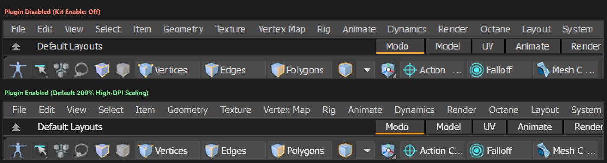
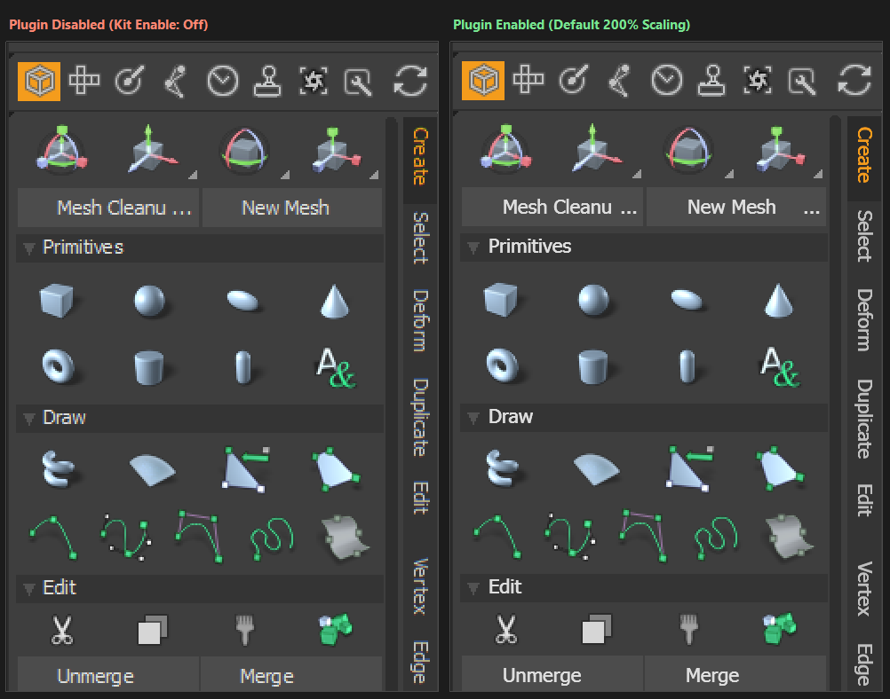
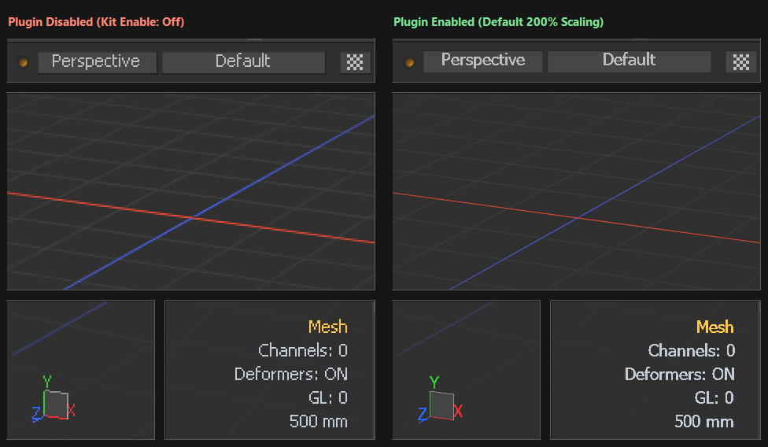
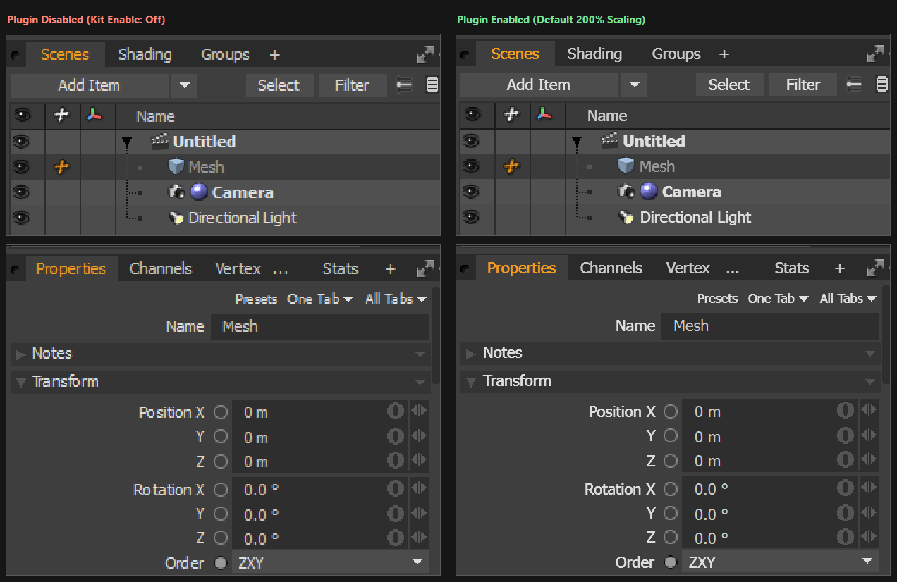

# Foundry Modo High-DPI Scaling Kit (`high_dpi_scaling`)

> **CAUSE**: *"Modo does not currently support 4k / High DPI monitors."*
> — Foundry Support Q100546: *Scaling Modo for 4k / High DPI monitors on Windows 10/11* ([Archived](https://web.archive.org/web/20260103155957/https://support.foundry.com/hc/en-us/articles/360007725379-Q100546-Scaling-Modo-for-4k-High-DPI-monitors-on-Windows-10-11))

Because Modo officially lacks native High-DPI support on Windows, Windows renders Modo at low resolution and stretches the entire application window on high-resolution displays—resulting in **low-resolution 3D viewports**, **blurry/pixelated UI text**, and **pixelated icons**. This kit fixes the 3D viewports and UI text by enabling true native High-DPI rendering for **high-resolution 3D OpenGL viewports** and **crisp 2D UI text** in **Foundry Modo 16 & Modo 17** on Windows.

## Comparison (200% Scaling)

### 1. Top Menu Bar, Layout Tabs & Selection Toolbar


### 2. Tool Palette & 90° Vertical Tabs


### 3. 3D OpenGL Viewport, Axes Grid, Gizmo & HUD


### 4. Item Tree (`Scenes`) & `Properties` Controls


## Requirements

- **OS**: Windows 10 / 11 (x64 only)
- **Modo**: Foundry Modo 16.x & Modo 17.x
- **Tested Versions**: Modo 16.1, Modo 17.1

> **Note**: I am not an active Modo user, so testing and feedback from the community are very welcome! If you run into any bugs or edge cases in your workflow, please feel free to open an [issue](../../issues).

## Features

- **High-Resolution 3D OpenGL Viewports**: Renders 3D viewports, wireframes, axes/grids, gizmos, and HUD overlays at full native screen resolution instead of stretched low resolution.
- **Crisp 2D Text & Vertical Tabs**: Native High-DPI font rendering across all menus, toolbars, item trees, channel controls, and 90° rotated vertical tabs.
- **Modo 16 & Modo 17 Support**: Single plugin supporting both Modo 16 (Qt5) and Modo 17 (Qt6) on Windows.

## Installation & Usage

1. Download `high_dpi_scaling.lpk` from the [latest release](../../releases/latest), double-click it (or drag and drop it into Modo) to install, then restart Modo.
2. **Default Behavior**: By default, `Scaling Mode` is set to **`Use System Setting`**, which automatically follows your Windows display scaling. In most cases, no further configuration is needed.
3. **Customizing Scaling**: To manually change the scaling factor or disable scaling, go to **`System -> Preferences -> Defaults -> UI -> Interface Scaling`** (restart Modo after changing settings to take effect):
   - **Scaling Mode**: Choose `Use System Setting`, `Use Custom Scaling`, or `Do Not Scale`.
   - **Custom Scaling Factor**: Select from the 4 preset options (`100%`, `125%`, `150%`, `200%`) when `Use Custom Scaling` is selected.

## FAQ

**Q: Why are 2D icons and button graphics still pixelated?**
- Unlike vector text and 3D viewports (which can be rendered natively at any resolution), Modo's built-in icons and 2D widget graphics are fixed low-resolution bitmaps. Applying interpolation filtering (such as bilinear or bicubic smoothing) only blurs their crisp pixel edges without adding real detail, so they are kept unmodified.

**Q: What if I previously enabled `modo.exe` Compatibility High-DPI Override (from Foundry's Q100546 article)?**
- Please **uncheck "Override high DPI scaling behavior"** in `modo.exe -> Properties -> Compatibility -> Change high DPI settings`. Leaving it set to `System` or `System (Enhanced)` will conflict with the plugin's native High-DPI rendering, and leaving it set to `Application` will prevent the plugin's `Do Not Scale` mode from restoring default Windows scaling.

## How It Works

1. **In-Memory High-DPI Bootstrap**: Because `modo.exe` embeds `<dpiAware>false</dpiAware>` in its manifest and initializes Qt before loading Kits, the `lxserv` Python bootstrapper (`high_dpi_scaling_plugin.py`) reads the saved scaling config, sets `__COMPAT_LAYER=HighDpiAware` and `QT_SCALE_FACTOR` in process memory (without modifying the Windows Registry or `modo.exe` on disk), and relaunches `modo.exe` before any window is created.
2. **3D OpenGL Viewport Hooks**: Even with Qt High-DPI enabled, Modo's internal 3D viewport pipeline (`front*.dll` / `frame*.dll` / `modo.exe`) allocates `QOpenGLFramebufferObject` surfaces at 1x logical resolution. `high_dpi_scaling.dll` hooks FBO creation, `AGLViewport`, `AGLScissor`, and `blitFramebuffer` to render 3D viewports at full physical pixel resolution while returning logical dimensions to Modo's camera and picking logic.
3. **2D UI, Text & Vertical Tab Hooks**: Modo's `OPALDisp` 2D engine renders panels and text into 1x offscreen `QImage` buffers with `QFont::NoAntialias`. The DLL hooks offscreen `QImage` allocation to use physical High-DPI dimensions (`devicePixelRatio = scale`), upgrades fonts to `QFont::PreferAntialias`, and intercepts 90° vertical tab rotation so vertical tab text is rotated at native physical resolution instead of a 1x `ILxImage`.

## Build

```powershell
cmake --preset windows-x64
cmake --build --preset release
```

The built kit and installer package will be generated in `dist/high_dpi_scaling/` and `dist/high_dpi_scaling.lpk`.

## License

Licensed under the [Apache License, Version 2.0](LICENSE).

---

*Built with [Google Antigravity](https://antigravity.google/) (Gemini 4 Argon).*

*Disclaimer: Modo is a registered trademark of The Foundry Visionmongers Ltd. This project is an independent third-party plugin and is not affiliated with or endorsed by Foundry.*
